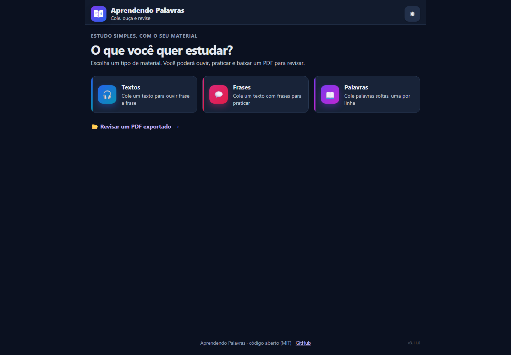
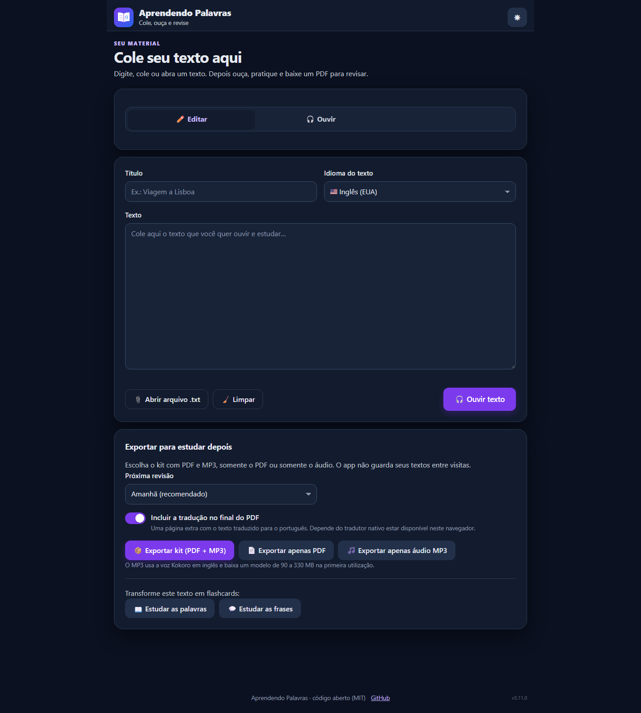
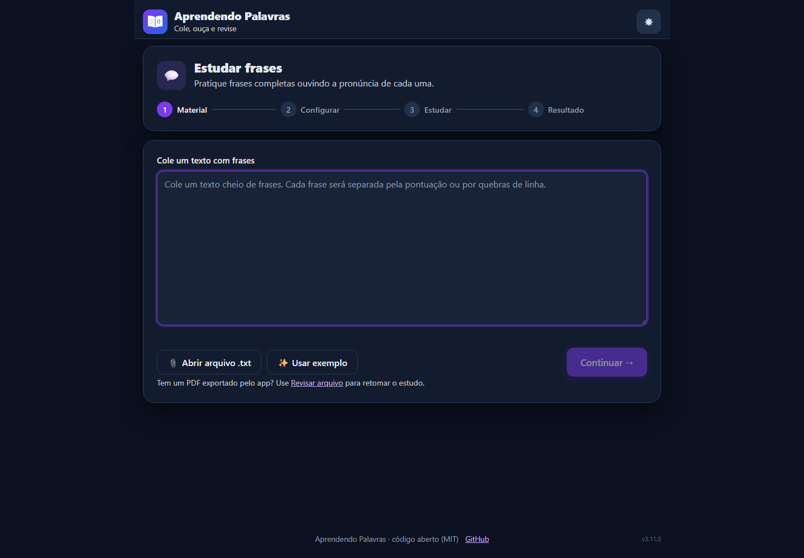
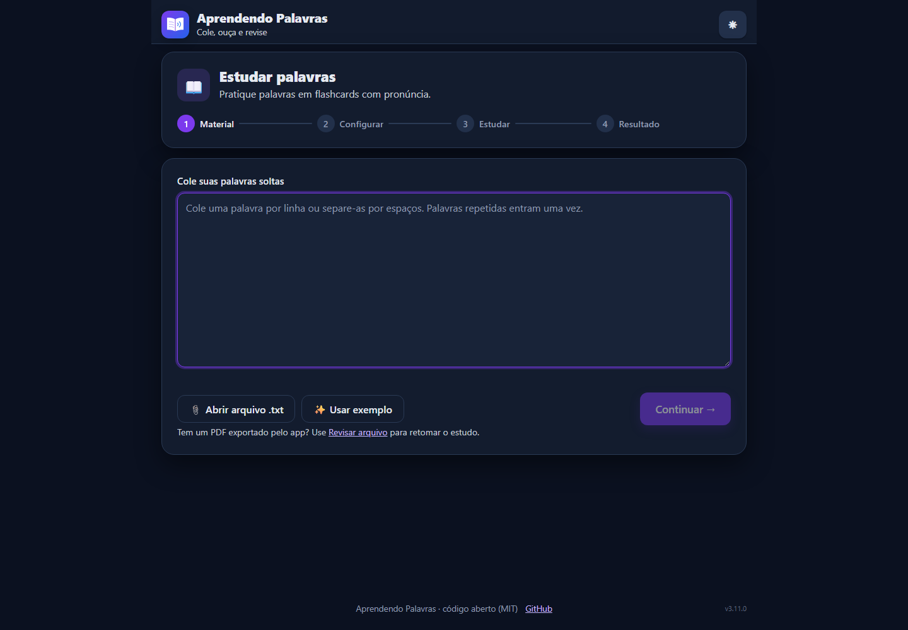
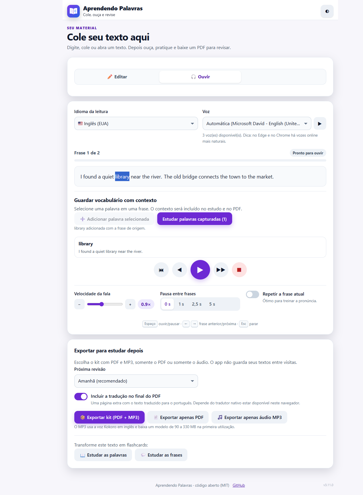
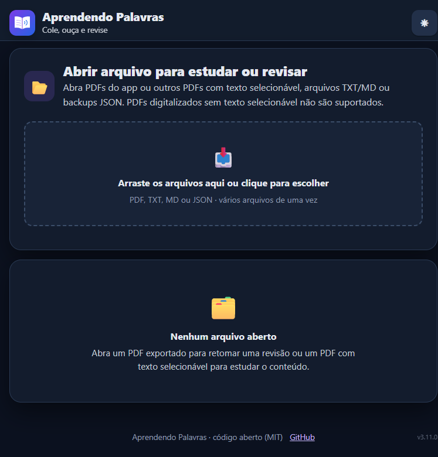
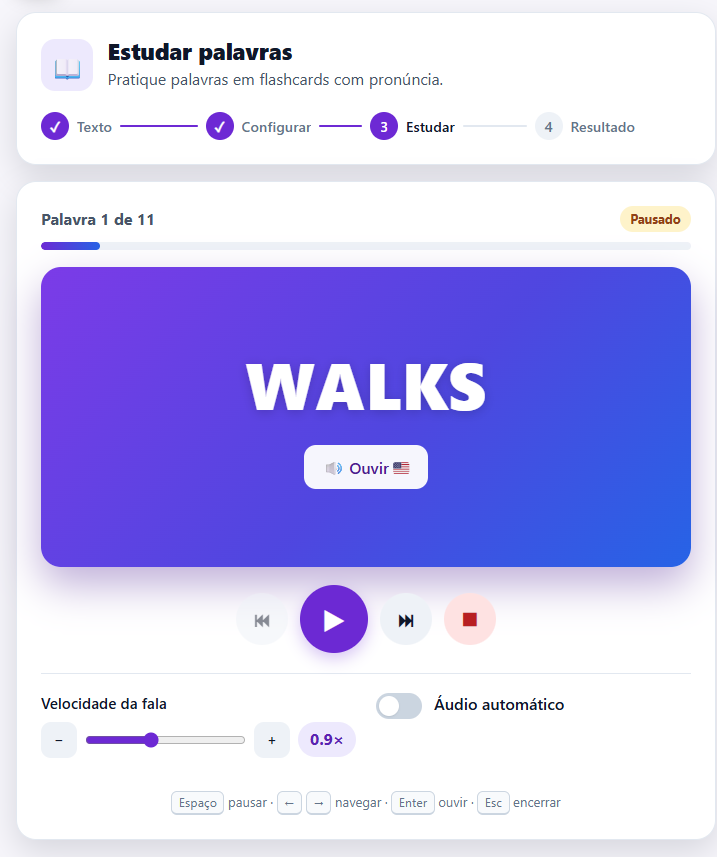
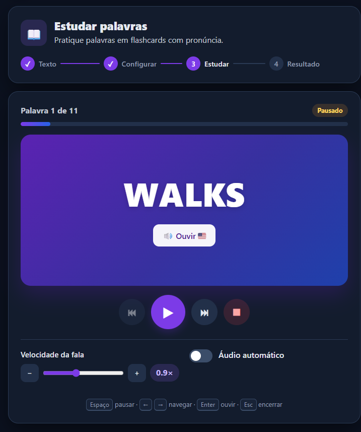

<div align="center">


# Aprendendo Palavras

**Estude textos, frases ou palavras com áudio e baixe um PDF para revisar depois.**

[](https://github.com/Joshpcbrrj/projeto-palavras/actions/workflows/ci.yml)
[](LICENSE)
[](https://web.dev/progressive-web-apps/)

[**Abrir o aplicativo →**](https://joshpcbrrj.github.io/projeto-palavras/)

</div>

## Capturas de tela

As imagens abaixo mostram a escolha entre os três modos de estudo, a entrada de material e a revisão do PDF.

| Escolher o modo                                                                                                                | Colar texto                                                                                                     |
| ------------------------------------------------------------------------------------------------------------------------------ | --------------------------------------------------------------------------------------------------------------- |
|  |  |

| Estudar frases                                                                                              | Estudar palavras                                                                                                                 |
| ----------------------------------------------------------------------------------------------------------- | -------------------------------------------------------------------------------------------------------------------------------- |
|  |  |

| Ouvir e estudar                                                                                           | Abrir e estudar documentos                                                                                        |
| --------------------------------------------------------------------------------------------------------- | ----------------------------------------------------------------------------------------------------------------- |
|  |  |

| Flashcards                                                                                                               | Tema escuro                                                                                    |
| ------------------------------------------------------------------------------------------------------------------------ | ---------------------------------------------------------------------------------------------- |
|  |  |

## O que o aplicativo faz

- **Oferece três modos diretos.** Em **Textos**, cole, digite ou abra um `.txt`/`.md` para ouvir a leitura. Em **Frases**, cole um texto com frases completas. Em **Palavras**, informe palavras soltas, de preferência uma por linha.
- **Ajuda a praticar listening.** Ouça o texto frase a frase, com destaque da frase atual, velocidade ajustável e controles de pausa, repetição e navegação.
- **Oferece três opções de exportação.** Gere um kit com PDF e MP3, somente o PDF ou somente o MP3. Os nomes incluem tipo, título e data; no kit, PDF e MP3 compartilham o mesmo nome-base.
- **Gera PDFs revisáveis.** O PDF inclui o idioma, o conteúdo e, se desejado, uma data de revisão. Ele pode ser reaberto no aplicativo para continuar o estudo.
- **Importa material de outras fontes.** Abra PDFs com texto selecionável, TXT, MD ou JSON e escolha ouvir textos, praticar frases ou extrair palavras. PDFs digitalizados sem texto selecionável não são suportados.
- **Mantém a sessão temporária.** Textos, arquivos abertos, preferências e andamento não são guardados entre visitas. Baixe o PDF para manter um material e selecione-o novamente na próxima sessão.
- **Funciona como PWA.** Instale no celular ou computador; a interface e os recursos principais ficam disponíveis offline depois do carregamento inicial.

### Fluxo recomendado

1. Na tela inicial, escolha **Textos**, **Frases** ou **Palavras**.
2. Cole seu material: um texto para leitura, um texto com frases completas ou palavras soltas (uma por linha ou separadas por espaços).
3. Escolha o idioma, ouça e pratique. Palavras informadas diretamente são mantidas mesmo quando são palavras comuns do idioma.
4. Baixe o PDF do modo escolhido. O nome inclui o tipo, o título e a data; a tradução para português é opcional e depende do tradutor nativo do navegador.
5. Em outra visita, abra **PDF ou arquivo para estudar/revisar**. PDFs exportados retomam a revisão; PDFs externos com texto selecionável podem ser ouvidos como texto ou encaminhados para frases e palavras.

Também é possível abrir PDFs antigos, TXT, MD e arquivos JSON de materiais de versões anteriores. A agenda de revisão é atualizada no próximo PDF baixado; ela não fica armazenada no aplicativo.

## Áudio e compatibilidade

### Leitura no aplicativo

O player usa a [Web Speech API](https://developer.mozilla.org/docs/Web/API/Web_Speech_API), a síntese de voz oferecida pelo navegador e pelo sistema operacional. Não há servidor de áudio nem custo por reprodução. A disponibilidade e a qualidade das vozes variam por dispositivo e idioma; o aplicativo não usa silenciosamente uma voz de outro idioma quando não encontra uma compatível.

As vozes marcadas pelo navegador como online podem ser processadas pelo provedor do navegador. Para uma experiência melhor, instale uma voz para o idioma estudado nas configurações de fala do seu dispositivo.

### Exportação opcional de MP3

O MP3 usa a voz neural Kokoro no navegador e está disponível **somente em inglês**; para outros idiomas, o app avisa que a pronúncia terá sotaque inglês. O arquivo é mono, otimizado para voz, e pode ser gerado sozinho ou junto com o PDF no kit. Na primeira utilização, o modelo pode exigir um download de **90 a 330 MB**.

### Tradução opcional no PDF

A tradução para português usa a API de tradução nativa do navegador, quando disponível. O suporte depende do navegador e do par de idiomas; quando indisponível, o PDF é gerado sem a tradução e o aplicativo informa isso. Não há integração com Gemini ou outra API de texto.

## Privacidade

- O aplicativo é estático e não tem backend, conta ou banco de dados de usuário.
- O texto e o progresso da sessão ficam apenas na memória da página e são descartados ao recarregar ou fechar.
- A leitura por voz usa os recursos do navegador; a síntese das vozes online pode envolver o provedor do navegador.
- Bibliotecas de PDF, modelo de MP3 e arquivos do PWA podem ser baixados de CDNs para habilitar os recursos e o uso offline. O texto não é enviado pelo aplicativo a um serviço de geração de texto.
- Dados legados gravados por versões anteriores nas chaves próprias do Aprendendo Palavras são removidos ao iniciar. Chaves genéricas de outros sites não são alteradas.

Consulte [SECURITY.md](SECURITY.md) para relatar vulnerabilidades.

## Executar localmente

O aplicativo usa HTML, CSS e ES modules nativos; não há etapa de build. Node.js 22 ou superior é necessário para executar o servidor de desenvolvimento e os testes.

```bash
git clone https://github.com/Joshpcbrrj/projeto-palavras.git
cd projeto-palavras
npm install
npm run dev
```

O Vite informa o endereço local, normalmente `http://localhost:5173`.

### Comandos

| Comando                 | Descrição                                    |
| ----------------------- | -------------------------------------------- |
| `npm run dev`           | Inicia o servidor de desenvolvimento         |
| `npm test`              | Executa os testes                            |
| `npm run test:coverage` | Executa os testes com relatório de cobertura |
| `npm run lint`          | Executa ESLint                               |
| `npm run format:check`  | Verifica a formatação com Prettier           |
| `npm run check`         | Executa lint, formatação e testes            |

## Arquitetura e qualidade

O PWA é servido pelo GitHub Pages. O service worker mantém os arquivos estáticos e as bibliotecas necessárias; preferências e materiais de estudo não são persistidos.

- [`docs/ARQUITETURA.md`](docs/ARQUITETURA.md) — módulos, fluxo do player, PDFs e cache offline.
- [`docs/FORMATO-PDF.md`](docs/FORMATO-PDF.md) — estrutura dos materiais exportados e compatibilidade.
- [`docs/ROADMAP.md`](docs/ROADMAP.md) — análise do produto e próximos passos.

Os testes usam Vitest e jsdom para validar extração, sessões, leitura em voz alta simulada, revisão de arquivos, integridade de PDFs e atualização do PWA. `npm run test:coverage` aplica os limites globais configurados em `vitest.config.js`.

Ao alterar os arquivos estáticos ou a política de segurança, execute `npm run check`. A versão publicada deve permanecer igual em `package.json`, `js/config.js` e `sw.js` para invalidar corretamente o cache do PWA.

## Contribuir

Relatos de bugs e propostas de melhoria são bem-vindos. Consulte [CONTRIBUTING.md](CONTRIBUTING.md) antes de abrir uma contribuição.

## Licença

Distribuído sob a licença [MIT](LICENSE).
