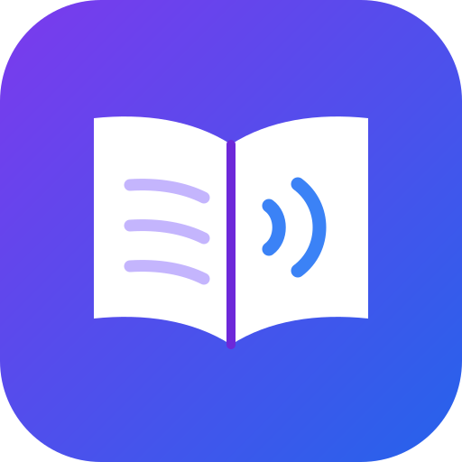
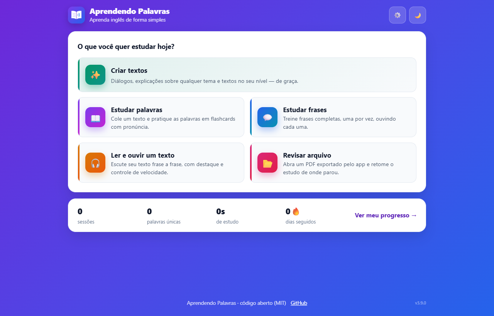
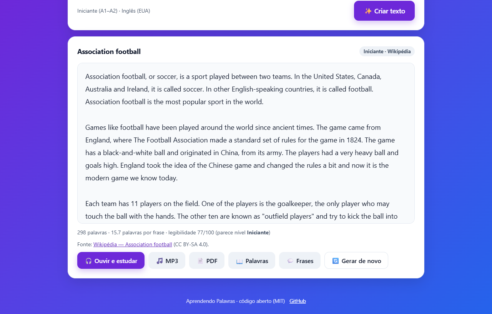
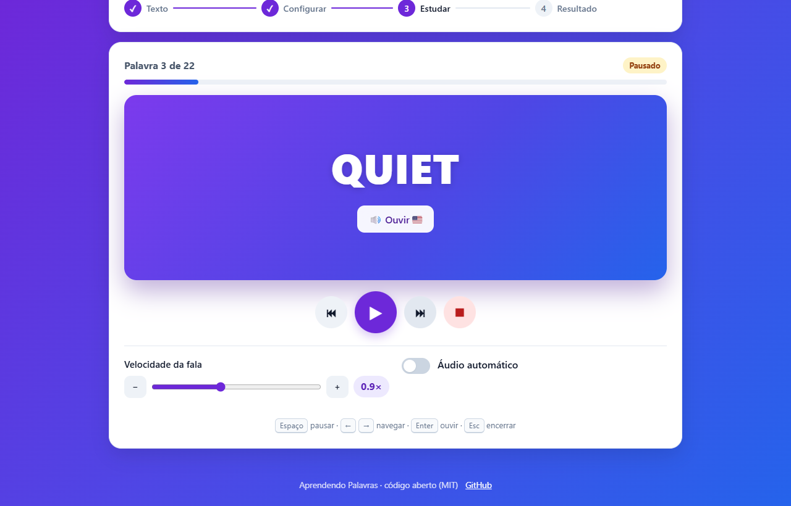
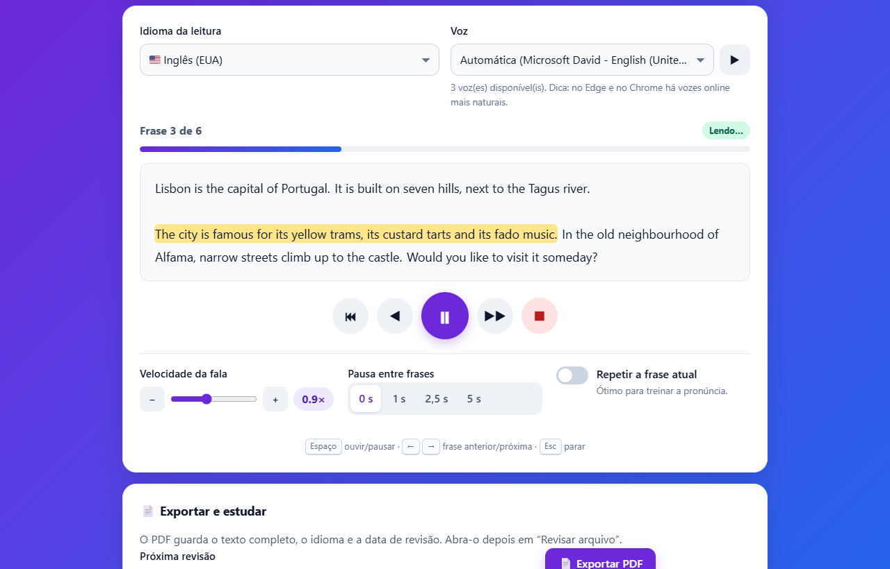
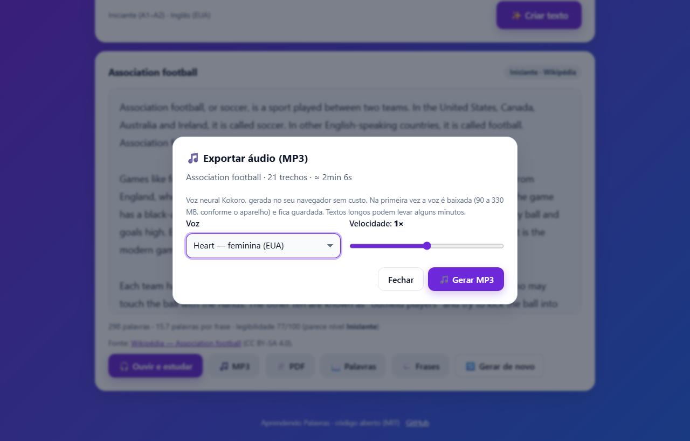
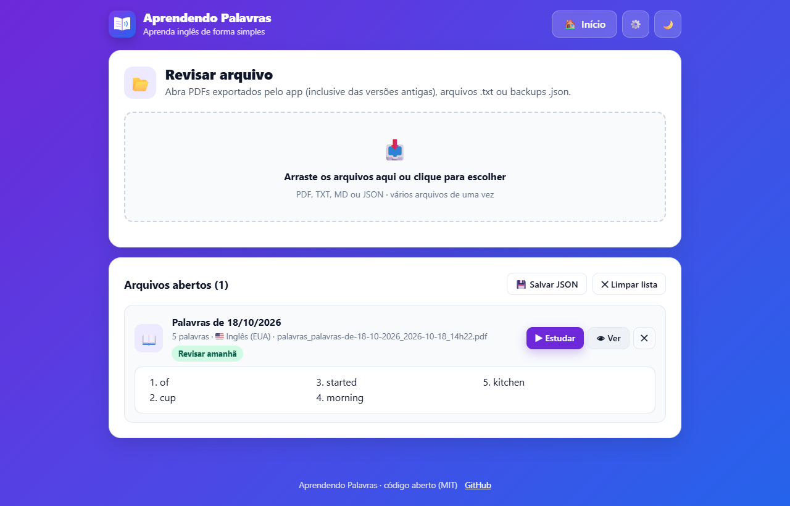
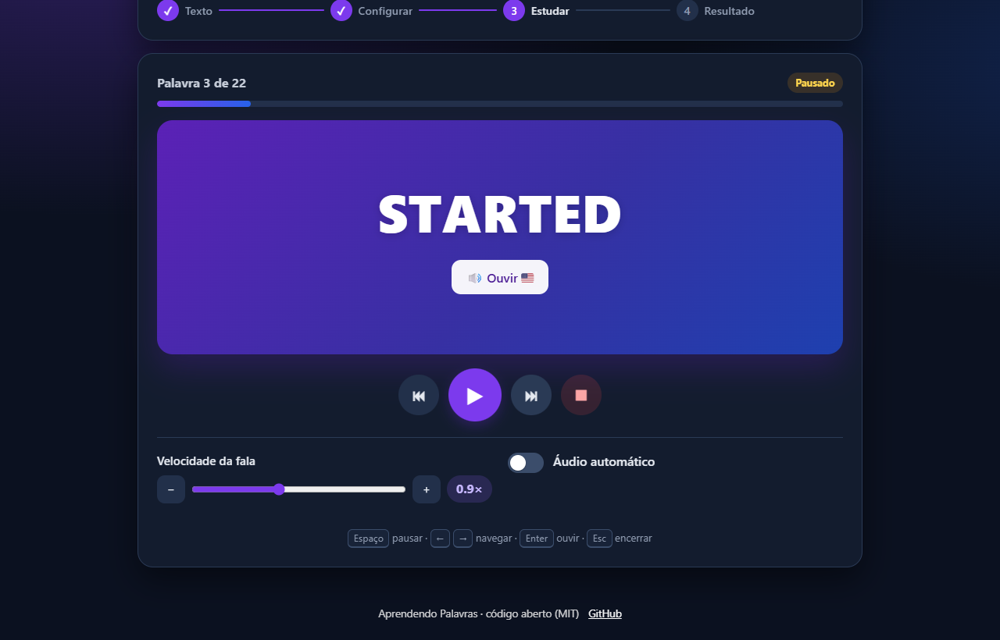
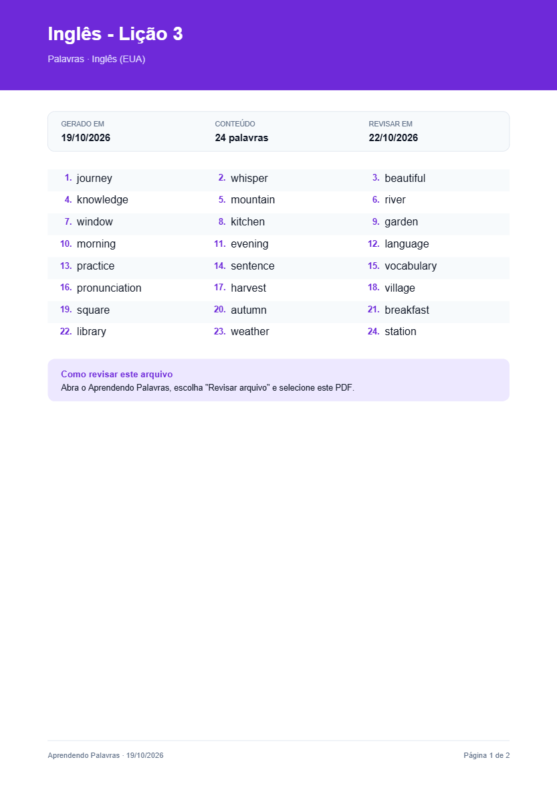
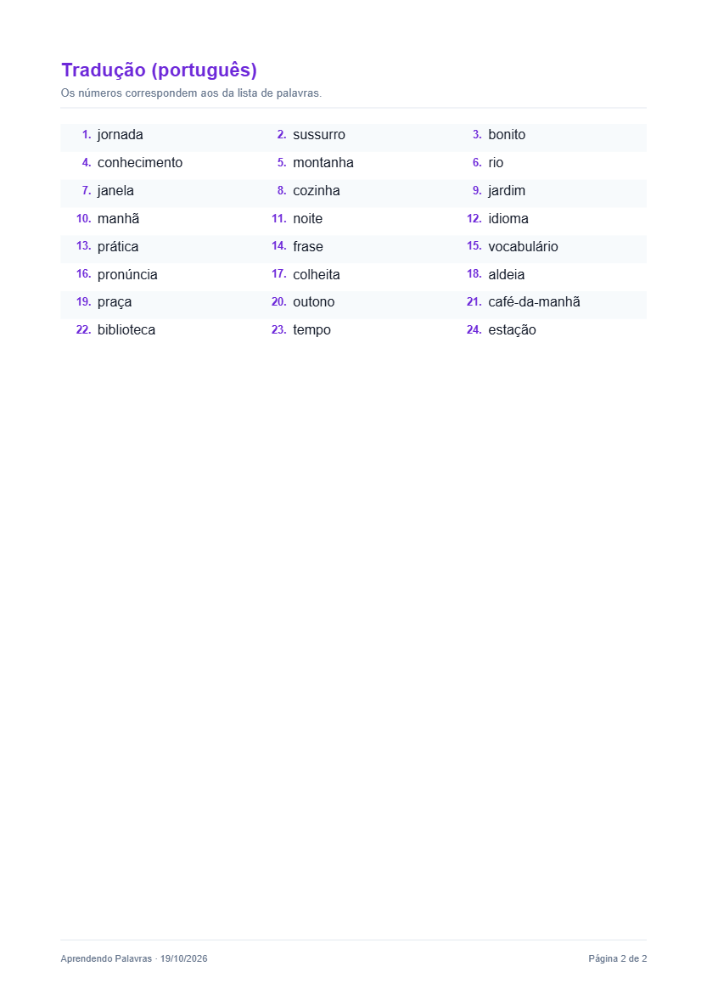

<div align="center">



# Aprendendo Palavras

**Aprenda inglês de forma simples: crie textos no seu nível, ouça com pronúncia, estude com flashcards e revise com PDFs e MP3.**

[](https://github.com/Joshpcbrrj/projeto-palavras/actions/workflows/ci.yml)
[](LICENSE)
[](https://web.dev/progressive-web-apps/)
[](#arquitetura)

[**Abrir o app →**](https://joshpcbrrj.github.io/projeto-palavras/)



</div>

---

## Sumário

- [Recursos](#recursos)
- [Como usar](#como-usar)
- [Criar textos](#criar-textos)
- [PDFs revisáveis](#pdfs-revisáveis)
- [Áudio, vozes e MP3](#áudio-vozes-e-mp3)
- [Executar localmente](#executar-localmente)
- [Arquitetura](#arquitetura)
- [Testes e qualidade](#testes-e-qualidade)
- [Compatibilidade](#compatibilidade)
- [Contribuindo](#contribuindo)
- [Licença e créditos](#licença-e-créditos)

## Recursos

|                                        |                                                                                                                                                                                                                                                                                                 |
| -------------------------------------- | ----------------------------------------------------------------------------------------------------------------------------------------------------------------------------------------------------------------------------------------------------------------------------------------------- |
| ✨ **Criar textos**                    | Diálogos sobre qualquer tema, explicações estilo enciclopédia (Wikipédia, com Simple English para iniciantes) e textos no seu nível (iniciante, intermediário, fluente — 700, 1.200 e 2.000 palavras). Tema pode ser digitado em português. Usa a Wikipédia e o Google Gemini (chave gratuita). |
| 🎵 **Exportar MP3**                    | Áudio de textos (com uma voz por pessoa nos diálogos) e da pronúncia das palavras/frases estudadas, com repetições, pausas e o número de cada item (para acompanhar no PDF) — grátis, com a voz neural Kokoro gerada no próprio navegador.                                                      |
| 📖 **Flashcards de palavras e frases** | Cole um texto e o app extrai as palavras (sem repetições e, se quiser, sem as muito comuns como “the”, “to”, “is”) ou as frases. Funciona com qualquer alfabeto, inclusive japonês e chinês.                                                                                                    |
| 🔊 **Pronúncia automática**            | Cada item é falado ao aparecer, com repetição de 1× a 3×, velocidade ajustável e escolha da voz.                                                                                                                                                                                                |
| ⏯️ **Controle total do estudo**        | Pausar, voltar, avançar e ouvir de novo — com atalhos de teclado.                                                                                                                                                                                                                               |
| 🎧 **Leitura de textos**               | O texto é lido frase a frase com destaque na tela; clique em qualquer frase para ouvir a partir dela, repita a frase atual ou adicione pausas.                                                                                                                                                  |
| 📦 **Kit de estudo**                   | PDF + MP3 com um clique, com o mesmo nome de arquivo. No fim do PDF, uma página com **tudo traduzido para o português** (mesma numeração ou mesmos parágrafos), para revisar rápido.                                                                                                            |
| 📄 **PDFs revisáveis**                 | Os PDFs exportados guardam os dados exatos do estudo e a data da próxima revisão. Abra-os depois em “Revisar arquivo” para continuar.                                                                                                                                                           |
| 🗓️ **Revisão espaçada**                | Cada revisão concluída agenda a próxima (1 → 3 → 7 → 14 → 30 → 60 dias). Revisões pendentes aparecem na tela inicial.                                                                                                                                                                           |
| 📈 **Progresso**                       | Sessões, tempo de estudo, palavras estudadas, textos/PDFs/MP3 criados, dias seguidos e backup em JSON que pode ser **juntado** entre aparelhos.                                                                                                                                                 |
| 🌙 **Tema claro e escuro**             | Segue o sistema automaticamente ou pela sua escolha.                                                                                                                                                                                                                                            |
| 📱 **PWA**                             | Instale no celular ou no computador e use offline.                                                                                                                                                                                                                                              |

<table>
  <tr>
    <td></td>
    <td></td>
  </tr>
  <tr>
    <td></td>
    <td></td>
  </tr>
  <tr>
    <td></td>
    <td></td>
  </tr>
</table>

## Como usar

1. **Criar um texto** — em **Criar textos**, escolha o modo (diálogo, mergulhar no tema ou por nível), digite o tema (pode ser em português), o nível (que também define o tamanho do texto) e clique em **Criar texto**. Depois, ouça, gere o PDF/MP3 ou transforme em flashcards.
2. **Estudar palavras ou frases** — cole um texto (ou abra um `.txt`), confira o idioma e a quantidade e clique em **Iniciar estudo**. Voz, repetição, velocidade, pausa e ordem ficam em **Mais opções**.
3. **Durante o estudo** — use os botões ou o teclado:

   | Tecla                     | Ação                    |
   | ------------------------- | ----------------------- |
   | <kbd>Espaço</kbd>         | Pausar / continuar      |
   | <kbd>←</kbd> <kbd>→</kbd> | Item anterior / próximo |
   | <kbd>Enter</kbd>          | Ouvir de novo           |
   | <kbd>Esc</kbd>            | Encerrar                |

4. **Ao terminar** — baixe o **kit de estudo** (PDF + MP3) ou só um deles, escolhendo quando quer revisar e se o PDF terá a tradução no final. O progresso da sessão é salvo automaticamente.
5. **Revisar** — no dia marcado, abra **Revisar arquivo**, selecione o PDF e clique em **Estudar** (ou **Ouvir**, para textos). Pode selecionar a pasta do kit inteira: os MP3 são ignorados, pois o PDF já guarda tudo. Vários PDFs do mesmo tipo e idioma podem ser combinados num único estudo.
6. **Ler e ouvir um texto** — cole o texto, vá para a aba **Ouvir** e acompanhe o destaque. Dali você também pode exportar o MP3 ou transformar o texto em flashcards.
7. **Configurações** (⚙️ no topo) — idioma de estudo, tema, chave do Gemini, preferência da IA (qualidade ou rapidez) e vozes do MP3.

## PDFs revisáveis

Cada PDF tem duas camadas:

- **O que você vê** — um layout limpo para ler e imprimir (palavras em colunas, frases numeradas ou o texto completo), com a data da próxima revisão. Textos longos têm os títulos de seção em destaque. No fim, opcionalmente, a tradução para o português.
- **O que o app lê** — um pacote com os dados exatos (itens, idioma, título e agenda de revisão) guardado nas propriedades do documento. Assim a revisão não depende de “adivinhar” o conteúdo a partir do texto do PDF.

<details>
<summary>Exemplo de PDF gerado (lista e página de tradução)</summary>


</details>

PDFs gerados pelas **versões anteriores** do app continuam funcionando: o conteúdo é reconstruído a partir do texto. Idiomas fora do alfabeto latino (russo, japonês, chinês, coreano) aparecem corretamente no PDF. Detalhes técnicos em [docs/FORMATO-PDF.md](docs/FORMATO-PDF.md).

## Criar textos

| Modo                 | Precisa de IA?              | Como funciona                                                                                                                     |
| -------------------- | --------------------------- | --------------------------------------------------------------------------------------------------------------------------------- |
| 💬 Diálogo           | Sim                         | A IA escreve uma conversa entre duas pessoas sobre o tema, no nível escolhido.                                                    |
| 🌍 Mergulhar no tema | Não (opcional para adaptar) | Busca o artigo na Wikipédia (Simple English para iniciantes) no tamanho do nível (700 a 2.000 palavras), com atribuição da fonte. |
| 📶 Por nível         | Não (melhor com IA)         | Com IA, escreve o texto no nível pedido e simplifica se ficar difícil; sem IA, usa a Wikipédia do nível mais próximo.             |

A IA é o **Google Gemini**: crie uma chave gratuita no [Google AI Studio](https://aistudio.google.com/app/apikey) (leva 1 minuto, só precisa de uma conta Google, sem cartão de crédito) e cole no painel da tela de criação — o painel traz um **passo a passo ilustrado**, um botão **Colar** e testa a chave na hora, explicando o problema se ela não funcionar. Responde em segundos e funciona no celular. Sem chave, os modos “Mergulhar no tema” e “Por nível” funcionam só com a Wikipédia. Limitações em [docs/ROADMAP.md](docs/ROADMAP.md).

### Tamanho dos textos

O nível define a dificuldade **e o tamanho** do texto — no mínimo 700 palavras, para dar um texto que valha a pena estudar:

| Nível         | Palavras (mínimo) | No PDF      |
| ------------- | ----------------- | ----------- |
| Iniciante     | 700               | ≈ 2 páginas |
| Intermediário | 1.200             | ≈ 4 páginas |
| Fluente       | 2.000             | ≈ 6 páginas |

- **Com o Gemini:** o texto é escrito em **2 a 4 partes ao mesmo tempo** (≈ 450 palavras cada, cada uma com um trecho do roteiro: o que é, história, como funciona, exemplos, prós e contras, futuro), então fica pronto em segundos mesmo nos níveis maiores. Uma **barra de progresso** mostra a porcentagem, as palavras já escritas e o tempo. Se alguma parte sair difícil demais para o nível, só ela é simplificada; se o total ficar abaixo do mínimo, a IA continua (até 2 vezes). Textos longos são divididos em seções com título.
- **Velocidade:** a IA usa raciocínio baixo (responde mais rápido) e, em **Configurações**, dá para trocar **Qualidade (Gemini Flash)** por **Rapidez (Flash-Lite)** — os dois grátis. Artigos da Wikipédia ficam guardados durante a visita, então “Gerar de novo” sobre o mesmo tema é mais rápido.
- **Só com a Wikipédia:** o artigo é usado até o tamanho do nível, sem pular parágrafos. A Simple English costuma ser curta; ela é completada com as seções do mesmo artigo na Wikipédia em inglês normal (para iniciantes, essa parte é mais difícil — o app avisa). Se o artigo inteiro for curto, o app também avisa.

### Tradução no final do PDF

Com a opção **Incluir a tradução no final do PDF** (ligada por padrão), o PDF ganha uma página extra com a tradução para o português:

- **Palavras e frases:** cada item traduzido, com o **mesmo número** da lista (o 7 da tradução é o 7 da lista).
- **Textos:** o texto inteiro traduzido, com os **mesmos parágrafos e títulos**, na mesma ordem.

O conteúdo em inglês continua limpo; a tradução fica separada, para conferir quando quiser. Quem traduz (grátis):

1. o **Google Gemini**, se a chave estiver configurada (traduz no contexto, com boa qualidade);
2. o **tradutor embutido do Chrome/Edge** (roda no aparelho; traduz frase por frase; na primeira vez o navegador baixa o pacote do idioma).

Se nenhum estiver disponível, o PDF sai sem a tradução e o app avisa. A tradução fica guardada no PDF: ao reabri-lo e exportar de novo (ou combinar listas), ela é reaproveitada e só o que falta é traduzido.

## Áudio, vozes e MP3

O áudio dentro do app usa a [Web Speech API](https://developer.mozilla.org/docs/Web/API/Web_Speech_API) — as vozes são as instaladas no seu dispositivo/navegador, então nada é enviado a servidores pelo app.

- O app escolhe automaticamente a voz mais natural disponível para o idioma (vozes marcadas como _Natural_, _Neural_, _Online_, _Premium_ ou do Google têm prioridade). Você pode escolher outra e testá-la com ▶; a escolha fica salva por idioma.
- **Melhor qualidade:** o Microsoft Edge oferece vozes neurais online muito naturais; o Chrome traz as vozes do Google.
- **Sem voz para um idioma?** O app avisa. Instale a voz nas configurações do sistema (Windows: _Configurações → Hora e idioma → Fala_; Android: _Configurações → Idioma → Saída de conversão de texto em voz_; iOS/macOS: _Acessibilidade → Conteúdo falado → Vozes_).
- Textos longos são lidos frase a frase, o que evita o corte de falas longas do Chrome e torna pausar/retomar confiável. Em diálogos, cada pessoa tem uma voz.

**Exportar MP3:** a Web Speech API não permite gravar o áudio, então o MP3 é gerado pela voz neural **Kokoro**, que roda no próprio navegador, grátis e sem conta; fala apenas inglês. Na primeira vez baixa de 90 a 330 MB.

- **Ouvir enquanto gera:** o áudio começa a tocar assim que os primeiros trechos ficam prontos.
- **Listas:** repetições, pausa entre itens e número de cada item (“Number 3… window”, para acompanhar no PDF).
- **Volume uniforme:** cada trecho é nivelado (o Kokoro começa as frases forte e termina baixo) e as emendas são suavizadas.
- **Tempo:** listas saem em segundos ou poucos minutos; textos longos levam minutos (bem menos com placa de vídeo). Gerar de novo com outras opções na mesma visita reaproveita o áudio já pronto.

## Executar localmente

O app é feito de arquivos estáticos (HTML, CSS e ES modules nativos) — **não há etapa de build**. Qualquer servidor estático funciona.

**Requisitos:** Node.js 22+ (apenas para o servidor de desenvolvimento e os testes).

```bash
git clone https://github.com/Joshpcbrrj/projeto-palavras.git
cd projeto-palavras
npm install
npm run dev        # http://localhost:5173
```

Sem Node, você pode usar, por exemplo, `python -m http.server` na pasta do projeto.

### Scripts

| Comando                           | Descrição                                          |
| --------------------------------- | -------------------------------------------------- |
| `npm run dev`                     | Servidor de desenvolvimento com recarga automática |
| `npm test`                        | Executa os testes                                  |
| `npm run test:coverage`           | Testes com relatório de cobertura (`coverage/`)    |
| `npm run lint` / `lint:fix`       | ESLint                                             |
| `npm run format` / `format:check` | Prettier                                           |
| `npm run check`                   | Lint + formatação + testes (o mesmo que o CI roda) |
| `npm run icons`                   | Gera os ícones PNG a partir de `icons/icon.svg`    |

### Publicação

O site é servido diretamente pelo GitHub Pages a partir da branch `main` (todos os caminhos são relativos). Ao publicar uma nova versão, atualize o número em três lugares — `version` no [`package.json`](package.json), `APP.versao` em [`js/config.js`](js/config.js) (é o que aparece no rodapé do app) e `VERSAO` em [`sw.js`](sw.js) (faz os usuários receberem os arquivos novos). Um teste confere se os três estão iguais.

## Arquitetura

```text
├── index.html            # página única; aplica o tema antes da primeira pintura
├── sw.js                 # service worker (offline + cache das bibliotecas externas)
├── manifest.json         # manifesto do PWA
├── css/                  # tokens de tema, componentes e telas (sem framework)
├── fonts/                # fonte de bandeiras (Windows)
├── icons/                # ícones do PWA
├── js/
│   ├── main.js           # inicialização e rotas
│   ├── config.js         # constantes (idiomas, limites, URLs das bibliotecas)
│   ├── audio/            # vozes, fala, leitor frase a frase e exportação MP3 (export/)
│   ├── core/             # DOM seguro, roteador, navegação e utilitários
│   ├── create/           # criação de textos (Wikipédia, Gemini, tamanho e nível) e tradução
│   ├── pdf/              # formato do pacote, exportação, importação e formatos antigos
│   ├── screens/          # telas (menu, criar, estudo, texto, revisar, progresso, configurações)
│   ├── services/         # armazenamento, preferências, progresso e exportação de PDF
│   ├── study/            # sessão de flashcards (sem dependência de interface)
│   ├── text/             # extração de palavras/frases
│   └── ui/               # componentes, diálogos, notificações e tema
├── scripts/              # utilitários (geração de ícones)
├── tests/                # testes (Vitest + jsdom)
└── docs/                 # documentação técnica e capturas de tela
```

Visão geral das decisões técnicas em [docs/ARQUITETURA.md](docs/ARQUITETURA.md).

## Testes e qualidade

- **Vitest** com testes que importam o código real: extração de texto, revisão espaçada, sessão de estudo, leitor de áudio (com síntese de voz simulada), progresso, backup e junção entre aparelhos, migração de dados, telas no jsdom, **geração + leitura de PDFs reais** (jsPDF → pdf.js, inclusive a página de tradução), criação de textos e tamanho por nível (Wikipédia e IA simuladas), tradução (Gemini e tradutor do navegador simulados), Gemini (streaming simulado), nivelamento de volume e **geração de MP3 real** (lamejs).
- Testes de integridade do projeto: lista de arquivos do service worker, Content-Security-Policy (hash do script e origens permitidas) e versão igual no `package.json`, `config.js` e `sw.js`.
- **ESLint** e **Prettier** rodam no CI e no pre-commit (Husky + lint-staged).

## Compatibilidade

| Navegador                            | Tudo (estudo, PDFs, criar textos, MP3) | Voz dentro do app                    | Tradução sem chave do Gemini |
| ------------------------------------ | -------------------------------------- | ------------------------------------ | ---------------------------- |
| Chrome / Edge (computador e Android) | ✅                                     | ✅ (Edge tem as vozes mais naturais) | ✅ (tradutor embutido)       |
| Safari (macOS e iOS 15.4+)           | ✅                                     | ✅                                   | — (use a chave do Gemini)    |
| Firefox                              | ✅                                     | ✅ (depende das vozes do sistema)    | — (use a chave do Gemini)    |

Os dados (progresso, preferências e a chave do Gemini, se você cadastrar) ficam só no `localStorage` deste navegador, protegidos por uma Content-Security-Policy que só permite falar com a Wikipédia, o Gemini, as CDNs das bibliotecas e o Hugging Face (modelo da voz). Use **Meu progresso → Exportar backup** para levar o progresso para outro aparelho: ao importar, escolha **Juntar** (soma os dois progressos sem contar nada em dobro, mesmo importando o mesmo arquivo de novo) ou **Substituir**. A tela inicial lembra de fazer backup quando o último tem mais de 2 semanas.

## Contribuindo

Contribuições são bem-vindas! Leia o [guia de contribuição](CONTRIBUTING.md) e o [código de conduta](CODE_OF_CONDUCT.md). Para problemas de segurança, veja a [política de segurança](SECURITY.md). As mudanças de cada versão estão no [CHANGELOG](CHANGELOG.md).

## Licença e créditos

Distribuído sob a licença [MIT](LICENSE). © 2026 Josué B. Almeida.

- [jsPDF](https://github.com/parallax/jsPDF) (MIT) — geração de PDFs.
- [PDF.js](https://github.com/mozilla/pdf.js) (Apache-2.0) — leitura de PDFs.
- [kokoro-js](https://github.com/hexgrad/kokoro) e modelo Kokoro-82M (Apache-2.0) — voz neural para o MP3.
- [lamejs](https://github.com/zhuker/lamejs) (LGPL-3.0, carregado sem modificações a partir da CDN) — codificação MP3.
- Conteúdo da [Wikipédia](https://www.wikipedia.org/) sob [CC BY-SA 4.0](https://creativecommons.org/licenses/by-sa/4.0/); a fonte de cada texto é exibida no app e no PDF.
- Bandeiras no Windows: fonte _Twemoji Country Flags_ do projeto [country-flag-emoji-polyfill](https://github.com/talkjs/country-flag-emoji-polyfill), com gráficos do [Twemoji](https://github.com/jdecked/twemoji) © Twitter/X e colaboradores, licença [CC-BY 4.0](https://creativecommons.org/licenses/by/4.0/).
