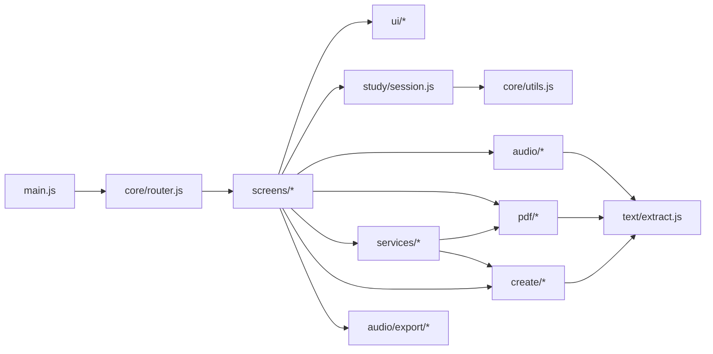

# Arquitetura

Visão geral para quem vai mexer no código.

## Princípios

- **Sem etapa de build.** O navegador carrega `js/main.js` como ES module e segue os `import`s. O GitHub Pages serve o repositório como está; o Vite é usado só como servidor de desenvolvimento.
- **Lógica separada da interface.** Regras de negócio (sessão de estudo, extração de texto, formato do PDF, progresso) não tocam no DOM e são testadas isoladamente. As telas só montam HTML e ligam eventos.
- **HTML seguro por padrão.** Toda interface é montada com a template tag `html` (`js/core/dom.js`), que escapa os valores interpolados.
- **Dados locais.** Tudo fica no `localStorage`; não há servidor.

## Módulos



| Pasta       | Responsabilidade                                                                                                                                                                                                                                                                                                                                                                                                                                                   |
| ----------- | ------------------------------------------------------------------------------------------------------------------------------------------------------------------------------------------------------------------------------------------------------------------------------------------------------------------------------------------------------------------------------------------------------------------------------------------------------------------ |
| `core/`     | `dom.js` (template `html`, leitura de arquivos, carregamento de scripts), `router.js` (rotas por hash), `nav.js` (navegação sem dependência circular), `utils.js` (datas, embaralhar, esperar cancelável).                                                                                                                                                                                                                                                         |
| `audio/`    | `voices.js` classifica e escolhe vozes; `speaker.js` fala com Promise e contorna bugs dos navegadores; `reader.js` lê textos longos frase a frase. `index.js` expõe as instâncias compartilhadas.                                                                                                                                                                                                                                                                  |
| `study/`    | `StudySession`: um único laço assíncrono cancelável (mostra → fala → espera → avança). Pausar/avançar cancelam o laço anterior com `AbortController`, então nunca há dois temporizadores.                                                                                                                                                                                                                                                                          |
| `text/`     | Extração de palavras/frases com `Intl.Segmenter` (quando disponível), filtro de palavras muito comuns (`comuns.js`) e divisão do texto em trechos para leitura, preservando a posição de cada trecho no original (usada no destaque).                                                                                                                                                                                                                              |
| `pdf/`      | `format.js` (pacote de dados e revisão espaçada), `exporter.js` (layout com jsPDF), `raster.js` (texto não latino como imagem), `importer.js` (PDF/TXT/JSON), `legacy.js` (formatos v1/v2), `libs.js` (carregamento sob demanda).                                                                                                                                                                                                                                  |
| `services/` | `storage.js` (localStorage tolerante a falhas), `settings.js` (preferências + migração das chaves antigas), `progress.js` (sessões, estatísticas, materiais criados, agenda de revisões, backup com junção entre aparelhos — contadores por origem, combinados pelo maior valor —, lembrete de backup, migração da v2), `export.js` (exportação única de PDF para todas as telas: pacote + tradução no fim + histórico + agenda; reaproveita traduções já feitas). |
| `screens/`  | Uma classe por tela com `montar(raiz)`, `desmontar()` e, opcionalmente, `podeSair()` (pergunta antes de sair de um estudo não salvo).                                                                                                                                                                                                                                                                                                                              |
| `ui/`       | Componentes compartilhados, diálogo modal, notificações, tema, diálogo do MP3/kit (`mp3Dialog.js`: opções e ouvir enquanto gera), botões de exportação (`exportActions.js`) e painel da IA com o passo a passo da chave (`aiPanel.js`, `guiaChave.js`).                                                                                                                                                                                                            |

### Criação de textos (`js/create/`)

| Arquivo                   | Responsabilidade                                                                                                                                                                                                                      |
| ------------------------- | ------------------------------------------------------------------------------------------------------------------------------------------------------------------------------------------------------------------------------------- |
| `wikipedia.js`            | Busca bilíngue (tema em português → link interlíngua para o idioma de estudo), Simple English para iniciantes, limpeza e corte do artigo no tamanho do nível (sem pular parágrafos).                                                  |
| `levels.js`               | Orientações por nível (CEFR), tamanho por nível (700 / 1.200 / 2.000 palavras) e métrica de legibilidade (Flesch).                                                                                                                    |
| `prompts.js`              | Montagem dos pedidos para a IA e limpeza das respostas (markdown, introduções, formato "Nome: fala").                                                                                                                                 |
| `gemini.js` + `engine.js` | IA pelo Google Gemini (chave gratuita do usuário, streaming SSE); `engine.js` devolve o motor pronto ou `null` sem chave.                                                                                                             |
| `translate.js`            | Tradução para o fim do PDF: Gemini (no contexto, em JSON) ou tradutor embutido do Chrome/Edge (`Translator`, com limite de tempo). Traduz parte por parte (parágrafos/títulos ou itens) para manter a correspondência com o original. |
| `generator.js`            | Orquestra os três modos: busca a referência (completando a Simple English curta com a Wikipédia em inglês), chama a IA, pede para continuar textos curtos e aplica alternativas (sem internet → só IA; sem IA → Wikipédia).           |

### Exportação de áudio (`js/audio/export/`)

A Web Speech API não permite gravar o áudio, então o MP3 é gerado por outro motor:

```text
planejarAudio(conteúdo) → trechos [{texto, voz, pausa}]
        │   (número + item num trecho só; frases curtas do mesmo parágrafo agrupadas)
        │
        ├─ KokoroMotor (Web Worker, kokoro-js, vozes neurais em inglês, grátis;
        │  usa a placa de vídeo quando disponível)
        │
        ├─ prepararTrecho: apara o silêncio, nivela o volume (nivelar) e suaviza as bordas
        │  → guardado num cache da sessão (voz|velocidade|texto), reaproveitado ao gerar de novo
        │
        ├─ OuvirEnquantoGera (preview.js): toca cada trecho assim que fica pronto (Web Audio)
        │
Mp3Builder (lamejs): junta os trechos + silêncios em um único MP3 mono 24 kHz
```

| Arquivo            | Responsabilidade                                                                                   |
| ------------------ | -------------------------------------------------------------------------------------------------- |
| `plan.js`          | `planejarAudio`: divide o conteúdo em trechos, escolhe a voz (diálogos) e define as pausas.        |
| `engines.js`       | `KokoroMotor`: conversa com o Web Worker e escolhe placa de vídeo (WebGPU) ou processador (WASM).  |
| `kokoro-worker.js` | Web Worker que carrega o kokoro-js e sintetiza cada trecho fora da thread principal.               |
| `mp3.js`           | `prepararTrecho` (aparar, `nivelar`, `suavizarBordas`) e `Mp3Builder` (codificação com o lamejs).  |
| `preview.js`       | `OuvirEnquantoGera`: toca os trechos à medida que ficam prontos.                                   |
| `index.js`         | `gerarMp3`: junta tudo, com cache da sessão; `criarMotor` mantém um único motor de voz por visita. |

Cada chamada à voz tem um custo fixo (≈ 1,5 s); por isso o planejamento reduz o número de trechos. As medições que motivaram o nivelamento e os agrupamentos estão em [ROADMAP.md](ROADMAP.md#14-áudio-qualidade-e-velocidade-versão-34).

## Ciclo de vida das telas

O roteador lê o hash (`#/palavras`), pergunta à tela atual se pode sair (`podeSair`), chama `desmontar()` (que para áudio, temporizadores e listeners globais) e monta a próxima. Dados entre telas (ex.: itens de um PDF para os flashcards) são passados por `navegar(rota, parametros)`.

## Áudio

```text
TextReader ──trechos──▶ Speaker.falar(texto, {idioma, velocidade, signal})
StudySession ──item──▶      │
                            ├─ VoiceManager.escolher(idioma)  → melhor voz / preferida
                            └─ speechSynthesis.speak(utterance)
```

`Speaker.falar` resolve quando a fala termina, quando é cancelada (pelo `signal` ou por outra fala) ou após um tempo-limite de segurança proporcional ao tamanho do texto.

## Temas e estilos

`css/base.css` define tokens (`--superficie`, `--texto`, `--primaria`...) em `:root` e os redefine em `:root[data-theme='dark']`. Componentes usam só os tokens, então o tema escuro não precisa de regras específicas. O tema é aplicado por um script inline no `<head>` antes da primeira pintura.

## Offline

`sw.js` guarda todos os arquivos do app (lista explícita, verificada por teste) e, à parte, as bibliotecas externas com versão fixa na URL (jsPDF e PDF.js do cdnjs são pré-carregadas; Kokoro e lamejs do jsDelivr ficam em cache após o primeiro uso). O modelo de voz é guardado pelas próprias bibliotecas no Cache Storage do navegador. Ao publicar, troque a versão (em `sw.js`, `js/config.js` e `package.json` — um teste confere) para invalidar o cache; a versão aparece no rodapé do app.

O Web Worker `audio/export/kokoro-worker.js` importa a biblioteca por URL fixa; um teste garante que ela é igual à de `config.js`.

## Segurança (Content-Security-Policy)

`index.html` declara uma CSP em `<meta>`: código só do próprio site, do cdnjs e do jsDelivr; conexões só com a Wikipédia, o Gemini, as CDNs e o Hugging Face (modelo da voz). O script de tema inline é liberado por **hash**. O worker da voz herda a política, por isso `worker-src` inclui o jsDelivr (a biblioteca cria um worker a partir dele) e `connect-src` inclui `huggingface.co` e `*.hf.co`.

Ao adicionar uma biblioteca, uma API ou editar o script de tema, atualize a CSP — `tests/project.test.js` confere o hash e as origens usadas em `config.js`, e um MP3 que trave em “Preparando a voz” costuma ser bloqueio da CSP (veja o console do worker).
